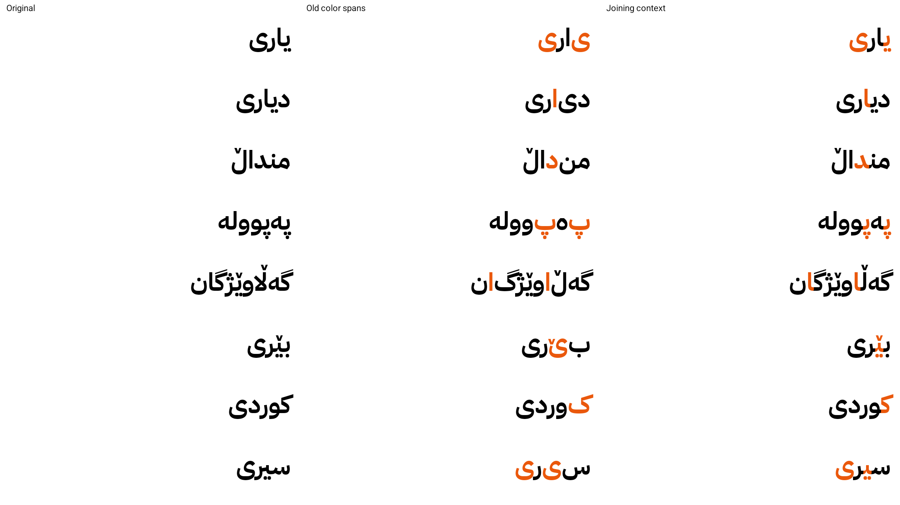

# Android story-letter joining — 2026-10-21

React Native 0.86 emits font metric spans for each attributed text fragment on Android, including nested fragments that only request a foreground color. The device shapes these fragments separately: removing explicit font props from nested Text did not fix the visible disconnections.

The story renderer now supplies U+200D joining context at both sides of an **existing** Arabic-script connection across a color boundary, using the Kurdish/common-Arabic joining types from Unicode 17 ArabicShaping.txt. It never forces connections after right-joining letters such as alef, dal, reh, waw or Kurdish ae. Combining vowel marks stay with the base letter. Web/iOS rendering is unchanged.

The original `text` is retained separately from `displayText`: speech, saved words, source text, karaoke offsets and the paragraph accessibility label use the authored text. Invisible controls occur only in Android display fragments. Target spans still change foreground color only.

## Device verification

Executed `JoiningProbe.java` through Android app_process on the connected RMX5051, with the app's actual IBM Plex Sans Arabic Bold font. No app installation or app-data modification was involved. The probe compares an unfragmented original, the old colored metric spans and the new joining-context spans. The previous disconnections were reproduced, and the corrected words were visually inspected in the resulting image, including یاری, دیاری, منداڵ, پەپوولە, گەڵاوێژگان, بێری, کوردی and سیری.

Raster comparisons are diagnostic, not pixel-equality assertions: color boundaries can change ligatures/kerning while retaining connected, correct letter forms. For example, یاری changed from 3223 silhouette differences with old spans to 26 with joining context; دیاری changed from 3252 to 3.

`scripts/android-text-probe/cases.cjs` generates the probe input in ignored `work/joining-probe/`. Compile the Java source against the installed Android SDK, convert it using d8, then run it via app_process with arguments: font path, cases JSON path, output PNG path. The probe initializes system fonts because app_process bypasses normal Zygote preloading.

This verifies Android shaping with the actual font and equivalent metric/color spans. Full in-app navigation, line wrapping and screen-reader behavior should also be checked after installing the updated APK.

## Shared red word highlighting — 2026-10-28

`HighlightedWord` now uses the same joining-context renderer for the new letter introduction, guided lesson example/recognition words, and the writing celebration. Previously the introduction did not highlight the target inside words, and the guided lesson changed the color of the entire word. Only matching letters (including their combining marks) now turn red, using `#dc2626`; the story reader uses the same color. Inline spans change foreground color only and inherit the surrounding word's font and size. Authored spelling, spoken text and accessibility labels remain unchanged. Natural non-joining boundaries after letters such as د and ا remain intact.

Regression tests cover Android, iOS and web rendering, repeated targets, combining marks, heh variants, compound وو, and words without a match. In the subsequent APK build session on 2026-10-28, the red native shaping probe was compiled again and run on the connected RMX5051 using the bundled bold font. Its rendered output was visually inspected: the red target retained the connected forms in یاری, دیاری, منداڵ, پەپوولە, گەڵاوێژگان, بێری, کوردی and سیری. This checks native shaping and foreground color; it does not replace full in-app navigation, wrapping and accessibility checks of the new screens.
